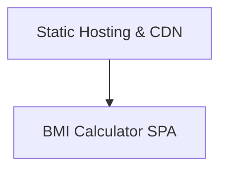
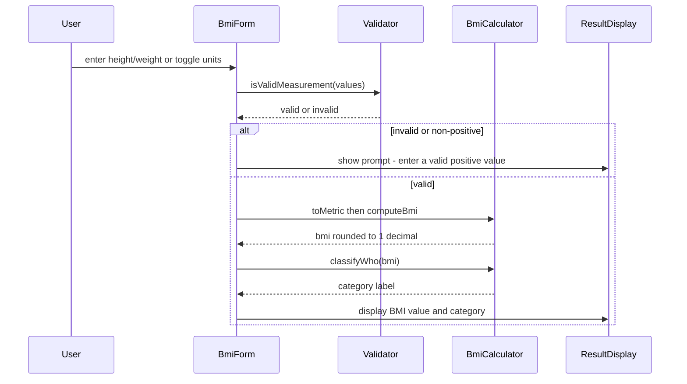

# Architecture

> Maintained by QuorQ AI SDLC. Text between `sdlc:auto` markers is regenerated; anything outside them is yours and is kept.

<!-- sdlc:auto:start narrative -->
## Overview

### ARCH-001 · approved · source: architecture:summary

Overall architecture is a single-page, client-side BMI calculator (React 19) with no backend and no data storage. It is deployed as static files to AWS S3 and served globally via CloudFront.

Approved architecture, version 1. User enters height/weight, toggles metric/imperial units, and instantly sees BMI (rounded to one decimal place) and WHO adult weight category plus a permanent 'not medical advice' disclaimer. All calculation runs client-side in the browser; nothing is sent to or stored on a server. FastAPI and PostgreSQL are named in the approved stack as formal placeholders only and are not provisioned, because there is no backend work and no data to persist.

**Related:** NFR-001, NFR-002

- ⚠ Input does not explicitly map this architecture to the known requirement keys US-001 through US-007; traceability from components/critical path to specific user stories is inferred only, not stated.

### ARCH-002 · approved · source: architecture:components:spa

The BMI Calculator SPA is the single React component that renders inputs, validates them, computes BMI, classifies it, and displays results plus disclaimer.

Component 'spa': BMI Calculator SPA (React 19). Single React page that renders input fields and unit toggle, validates height/weight, computes BMI client-side, classifies it into a WHO adult band, and shows the result and disclaimer. Stateless with no network calls.

**Related:** NFR-001, NFR-002

### ARCH-003 · approved · source: architecture:components:cdn

Static hosting and CDN layer (AWS S3 + CloudFront) serves the built static bundle worldwide over HTTPS.

Component 'cdn': Static Hosting & CDN (AWS S3 + CloudFront). Serves the built static bundle (HTML, JS, CSS) to the public quickly and cheaply worldwide. S3 stores the files; CloudFront caches and delivers them over HTTPS.

### ARCH-004 · approved · source: architecture:critical_paths

Defines the end-to-end client-side flow for computing and classifying BMI from user input, with no server round-trip.

Critical path: Client-side BMI calculation and classification. User enters height and weight in the selected unit system. Inputs are validated (must be numeric and positive). Imperial inputs are converted internally to metric; BMI = weight(kg) / height(m)^2 is computed and rounded to one decimal place; the WHO adult band is derived. Display updates instantly on every valid change with no page reload or backend call.

### ARCH-005 · approved · source: architecture:deployment_nodes

Two deployment nodes: an S3 bucket for static asset storage and a CloudFront distribution for edge caching/HTTPS delivery.

Deployment nodes: (1) Static Assets Bucket -- AWS S3, static file storage for HTML/JS/CSS build output. (2) Content Delivery Network -- AWS CloudFront, edge cache / HTTPS distribution.

### ARCH-006 · approved · source: architecture:technology_decisions:frontend

React 19 chosen as the sole working layer of the application, handling rendering, unit toggling, and live BMI recalculation in-browser.

Frontend: React 19 (alternatives considered: Vue 3, Svelte). React 19 renders the single responsive page, handles the metric/imperial toggle, re-runs the pure BMI calculation on every valid input change, and shows the category and disclaimer -- all in the browser with no round-trip.

**Related:** NFR-001, NFR-002

### ARCH-007 · approved · source: architecture:technology_decisions:backend

FastAPI 0.115 is named as a formal placeholder for the required backend layer but is not actually provisioned or used.

Backend: FastAPI 0.115 (alternatives considered: Flask, Express). Named as a formal placeholder for the backend layer. This product has no server-side logic -- calculation is client-side and nothing is saved -- so no FastAPI service is provisioned in this design.

### ARCH-008 · approved · source: architecture:technology_decisions:database

PostgreSQL 16 is named as a formal placeholder for the required database layer but is not actually provisioned since the app stores no data.

Database: PostgreSQL 16 (alternatives considered: SQLite, DynamoDB). Named to satisfy the required database layer. The app stores nothing -- no accounts, no history, no results -- so there is no data to keep and no database instance is provisioned.

**Related:** NFR-002, AC-017

- ⚠ Requirement/acceptance-criteria ids NFR-002 and AC-017 are referenced by the architecture input but are not among the known requirement keys (US-001..US-007) supplied for this phase, so full traceability to the requirements phase cannot be confirmed here.

### ARCH-009 · approved · source: architecture:technology_decisions:cloud

AWS (S3 + CloudFront) chosen as the cloud provider for cheap, fast, globally-scaled static file serving.

Cloud: AWS (alternatives considered: Cloudflare Pages, Netlify). The product is a single static page, so hosting means serving a handful of files fast and cheaply worldwide. AWS S3 plus CloudFront does exactly this, costs almost nothing at low traffic, and scales effortlessly.
<!-- sdlc:auto:end narrative -->

<!-- sdlc:auto:start building-blocks -->
## Building Block View

| ID | Name | Technology | Responsibility | Depends on |
|---|---|---|---|---|
| spa | BMI Calculator SPA | React 19 | Single React page that renders the input fields, unit toggle, validates height/weight, computes BMI client-side, classifies it into a WHO adult band, and shows the result and disclaimer -- all stateless with no network calls. | — |
| cdn | Static Hosting & CDN | AWS S3 + CloudFront | Serves the built static bundle (HTML, JS, CSS) to the public quickly and cheaply worldwide. S3 stores the files, CloudFront caches and delivers them over HTTPS. | spa |

<!-- sdlc:auto:end building-blocks -->

<!-- sdlc:auto:start runtime -->
## Runtime View

### Client-side BMI calculation and classification

User enters height and weight in the selected unit system. Inputs are validated (must be numeric and positive). Imperial inputs are converted internally to metric, BMI = weight(kg) / height(m)^2 is computed and rounded to one decimal place, and the WHO adult band is derived. Display updates instantly on every valid change with no page reload or backend call.

- **Components:** spa
- **Modules:** components/BmiForm, components/UnitToggle, components/ResultDisplay, lib/units, lib/bmi, lib/classify
- **Key functions:** toMetric(unitSystem, heightInput, weightInput), isValidMeasurement(value), computeBmi(weightKg, heightM), roundToOneDecimal(bmi), classifyWho(bmi)

<!-- sdlc:auto:end runtime -->

<!-- sdlc:auto:start deployment-view -->
## Deployment View

| Name | Service | Runtime | Scaling | Environment |
|---|---|---|---|---|
| Static Assets Bucket | AWS S3 | Static file storage (HTML/JS/CSS build output) | Managed by AWS, effectively unlimited object serving | dev |
| Content Delivery Network | AWS CloudFront | Edge cache / HTTPS distribution | Global edge auto-scaling, pay-per-use | dev |

| Source | Target | Protocol |
|---|---|---|
| Content Delivery Network | Static Assets Bucket | HTTPS |

<!-- sdlc:auto:end deployment-view -->

<!-- sdlc:auto:start decisions -->
## Architecture Decisions

| Layer | Choice | ADR |
|---|---|---|
| Frontend | React 19 | [ADR-0001](adr/frontend.md) |
| Backend | FastAPI 0.115 | [ADR-0002](adr/backend.md) |
| Database | PostgreSQL 16 | [ADR-0003](adr/database.md) |
| Cloud | AWS | [ADR-0004](adr/cloud.md) |
<!-- sdlc:auto:end decisions -->

<!-- sdlc:auto:start links -->
## Related Documents

- [Data Model](data-model.md)
- [API Specification](api/openapi.yaml)
- [Architecture Decision Records](adr/README.md)
<!-- sdlc:auto:end links -->
